# Lõputöö dokumentatsioon

### Lemmikloomatoidu koostisosade ja toitainete andmete analüüs ja normaliseerimine

**GitHubi aadress ja esitatav versioon:** [github.com/OksanaLab/Vet_Kliinik](https://github.com/OksanaLab/Vet_Kliinik)

**Grupiliikmed:** Oksana Kulik, Liina Saarm, Gea Varang, Astrit Õispuu


---

## Sisukord

1. [Sissejuhatus ja probleemi püstitus](#1-sissejuhatus-ja-probleemi-püstitus)
2. [Andmeallikad ja andmevoog](#2-andmeallikad-ja-andmevoog)
3. [Andmetöötlus ja kvaliteedikontroll](#3-andmetöötlus-ja-kvaliteedikontroll)
4. [Analüüs ja visualiseerimine (Power BI aruanne)](#4-analüüs-ja-visualiseerimine-power-bi-aruanne)
5. [Andmekorraldus ja turve](#5-andmekorraldus-ja-turve)
6. [Kokkuvõte ja arutelu](#6-kokkuvõte-ja-arutelu)
7. [Lisa A: Esitluse ja kaitsmise kava](#7-lisa-a-esitluse-ja-kaitsmise-kava)

---

## 1. Sissejuhatus ja probleemi püstitus

### 1.1. Eesmärk ja kasutaja

- **Töö eesmärk:** puhastada algandmestik, ühtlustada arvväärtused, eraldada toidu koostisosad ja toitained, et lõppkasutaja (veterinaararst või lemmikloomatoidu äpi arendaja) saaks dieedi määramisel teha õigeid ja turvalisi andmepõhiseid valikuid.
- **Väljund:** Power BI aruanne, mis kajastab andmestiku katvust, kvaliteeti ja toitainete võrdlusi.
- **Kelle probleemi lahendame?** Veterinaaräpi arendajale ja lõppkasutajale (veterinaararstile), kellel on vaja kiiret ja usaldusväärset ülevaadet lemmikloomatoidu tegelikust koostisest.
- **Miks lähteandmeid praegu otse võrrelda ei saa?** Andmed pärinevad erinevatest allikatest, mõõtühikud on erinevad, tekstid on mitmekeelsed (inglise, soome, rootsi) ning andmekvaliteet ja mastaabid vajavad süstemaatilist kontrolli.

### 1.2. Uurimisküsimused


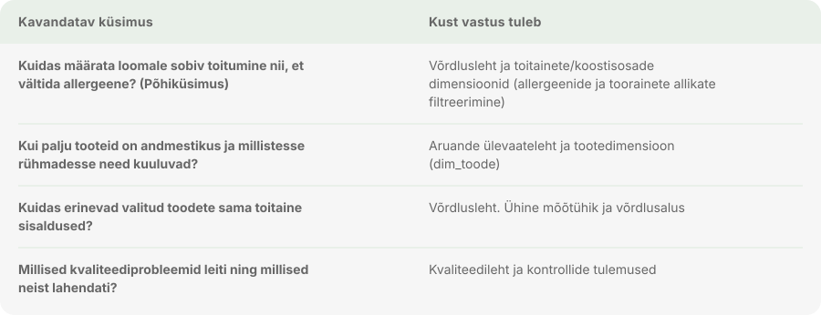

### 1.3. Ärimõisted

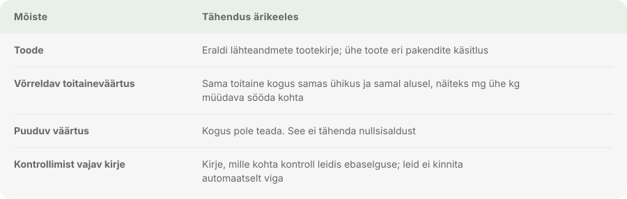

---

## 2. Andmeallikad ja andmevoog

### 2.1. Lähteandmed ja mahud

- **Dokumenteeritud lähteandmestik:** 15 202 rida ja 215 veergu. Töötlemise käigus on toortabelis `vet_raw` ja tööversioonis `vet_clean` tagatud algandmete säilivus.
- **Laadimine:** algandmed imporditi DBeaveri kaudu PostgreSQL-i andmebaasi skeemi `vet_analytics`. `vet_raw` säilitab puutumatu algseisu; `vet_clean` on paranduste ja puhastuse tööversioon.

### 2.2. Andmevoo arhitektuur

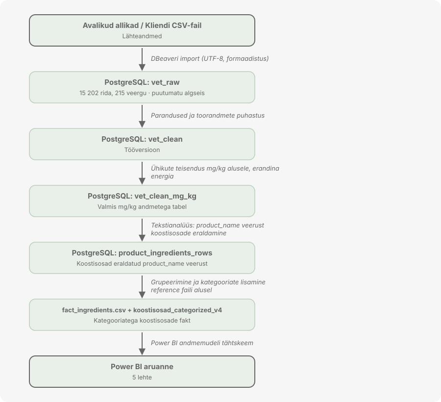

### 2.3. SQL andmemudel (tähtskeem)

Andmed on struktureeritud relatsioonilisse andmebaasi, mis tagab andmete puhtuse, selge auditeeritavuse ja valmisoleku Power BI aruandluseks.

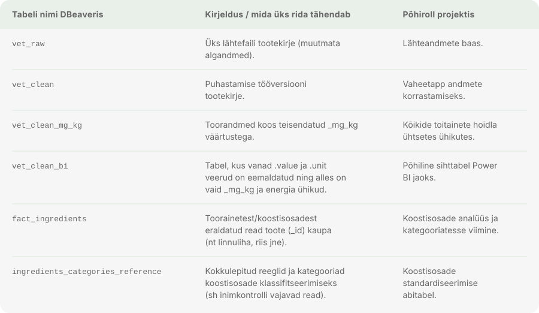


### 2.4. Tabelite vahelised seosed (Relationships)

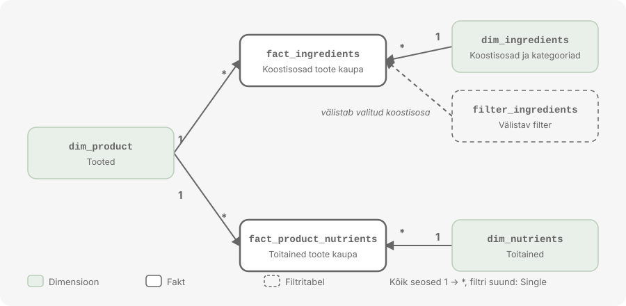

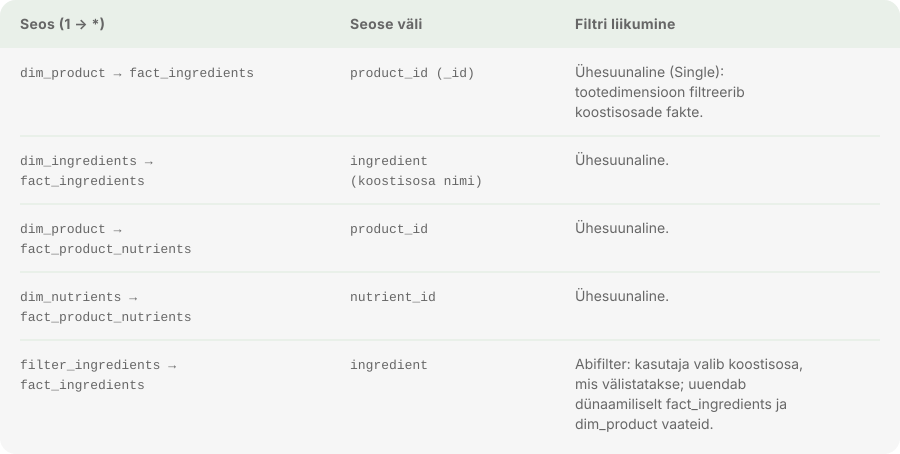

### 2.5. Filtrite liikumise loogika (Cross-filter direction)

- Kõik peamised seosed kasutavad **ühesuunalist (Single)** filtrisuunda dimensioonidest faktitabelitesse (1-to-\*). See hoiab ära ootamatud tulemused arvutustes, tagab parima jõudluse (*performance*) ja teeb DAX-mõõtude kirjutamise stabiilseks.
- **Allergeenide vältimise loogika:** kui veterinaar või kasutaja valib `filter_ingredients` või `dim_ingredients` kaudu keelatud aine (nt teatud teravilja või valgu), **välistatakse** see aine: `fact_ingredients` kaudu filtreeritakse välja need `product_id`-d, mis seda ainet sisaldavad. Seejärel kuvatakse `dim_product` ja `fact_product_nutrients` vaadetes *ainult* need tooted, mis on antud looma jaoks ohutud.

---

## 3. Andmetöötlus ja kvaliteedikontroll

### 3.1. Andmekaitse ja turve laadimisel

- Isikuandmed ja eriliigilised isikuandmed puuduvad täielikult, kuna andmestik hõlmab vaid lemmikloomatoidu tootjaid, nimetusi, koostisosi ja toitainete väärtuseid.
- Tundlikku äriinfot või konfidentsiaalseid finantsandmeid ei ole; töödeldakse avalikke turu- ja tootjaandmeid.

### 3.2. Andmekvaliteedi parandused ja auditeerimine

Algse CSV analüüsil tuvastati mitmeid struktuurseid, vormingulisi ja sisulisi vigu, mis on süstemaatiliselt parandatud ja auditeeritud. Andmekvaliteedi tagamiseks ei muudetud toorandmeid otse, vaid ehitati üles PostgreSQL vaated ja skriptid, mis tuvastavad automaatselt erinevad anomaaliad.

#### 3.2.1. Esialgsed struktuursed ja vormingulised parandused

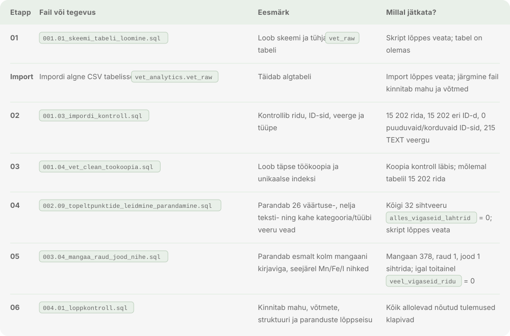

#### 3.2.2. Andmete dünaamiline unpivoteerimine ja tüübikontroll

Kuna algses tabelis on igal toitainel oma veerg (laia tabeli formaat), teisendatakse andmed andmekvaliteedi auditi käigus ridadeks (*long format*), kasutades `CROSS JOIN LATERAL` konstruktsiooni.

Enne arvutuste tegemist kontrollitakse regulaaravaldise abil, kas tekstiline väärtus on korrektne number:

- **Numbriline kontroll:** avaldis `^[+-]?([0-9]+(\.[0-9]+)?|\.[0-9]+)$` tagab, et string teisendatakse numbriliseks (`::numeric`) ainult korrektsel juhul.
- **Turvameede:** vigase teksti või erisümbolite esinemisel määratakse väärtuseks automaatselt `NULL`, mis hoiab ära tüübiteisenduse vead.

### 3.3. IQR-põhine anomaaliate tuvastamine ja kvaliteedisildid (flags)

Andmete puhtuse ja usaldusväärsuse tagamiseks arvutatakse igale toitainele esimese (`Q1`, 25%) ja kolmanda (`Q3`, 75%) kvartiili põhjal statistilised piirid. Süsteem märgistab iga kirje automaatselt spetsiaalse staatusmärgiga (flag).

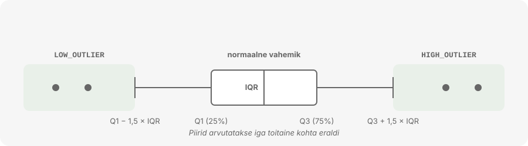

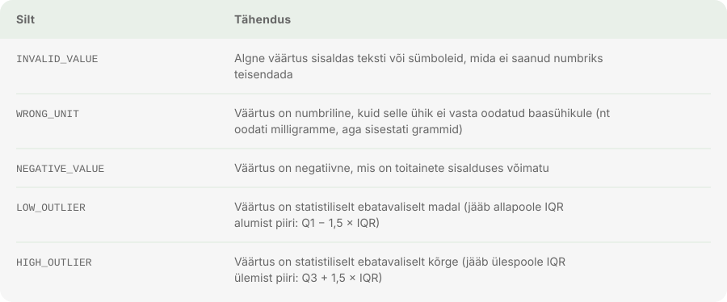

### 3.4. Andmete kontroll ja valideerimine andmebaasis

Pärast töötluse lõpetamist saab kontrollida uue tabeli olemasolu ja ridade arvu vastavust järgmiste päringutega:

```sql
-- Uue tabeli esmased read
SELECT *
FROM vet_analytics.vet_clean_mg_kg
LIMIT 10;

-- Ridade arvu võrdlus algtabeliga
SELECT
    (SELECT COUNT(*) FROM vet_analytics.vet_clean)       AS source_rows,
    (SELECT COUNT(*) FROM vet_analytics.vet_clean_mg_kg) AS normalized_rows;
```

**Tõend:** `source_rows` ja `normalized_rows` peavad olema täpselt võrdsed (15 202 rida).

### 3.5. NULL väärtuste tähendus

Normaliseeritud veerus esinev `NULL` ei tähenda automaatselt, et andmed on kadunud, vaid seda, et antud väärtust ei saanud olemasolevate reeglite alusel usaldusväärselt normaliseerida. See võib tuleneda järgmistest asjaoludest:

- algne väärtus oli `NULL` või tühi;
- algne väärtus ei olnud korrektne number;
- ühikut ei tuntud (tundmatuid ühikuid ei arvata ära, et vältida valeandmete teket).

### 3.6. Teisendamine ja rikastamine

- **Mg/kg teisendus:** kõik toitainete väärtused konverteeriti ühtsele standardsele alusele (milligrammi kilogrammi kohta, mg/kg), võttes arvesse algühikut ja koguse alust.
- **Erandid:** energia (kalorid) jäetakse eraldi mõõtühikusse; IU (rahvusvahelised ühikud) teisendused viidi läbi vastavalt toitaine spetsiifikale.
- **Säilitamine:** andmebaasis säilitatakse algväärtus, algühik ning teisenduse staatus (auditeeritavus).

---

## 4. Analüüs ja visualiseerimine (Power BI aruanne)

### 4.1. Aruande struktuur ja lehed

Aruanne on jaotatud viieks loogiliseks vaheleheks, millest igaüks vastab konkreetsele kasutaja küsimusele:

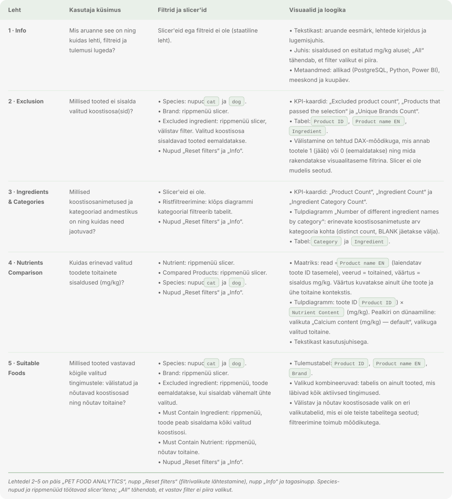


## 5. Kokkuvõte ja arutelu

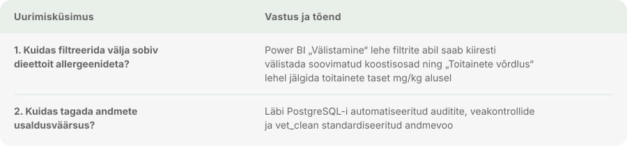

- **Praktiline kasutus:** süsteem annab veterinaaridele ja rakenduste loojatele kindla aluse loomade toitumise ja eridieetide planeerimiseks.
- **Piirangud:** analüüs toetub esitatud tootjaandmetele ja avalikele allikatele; andmetes esinevate puuduvate väärtuste korral ei asendata neid eelduslike arvudega (**puuduv ≠ 0**).

---
