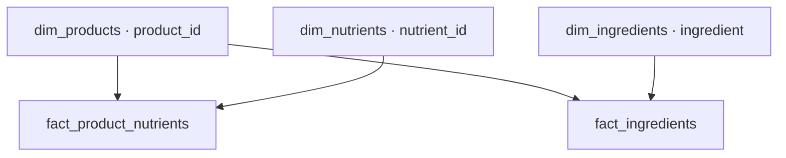

# Andmebaasi ja Power BI andmemudeli taastamine nullist

Juhend kirjeldab üht konkreetset teed: **algne puhastamata CSV → puhastus → ühikute normaliseerimine → koostisosade eraldamine → kategoriseerimine → Power BI andmemudel**. Kaasas on kõik selle tee sisendfailid ja koodid.

## 1. Mida saab selle paketiga taastada?

Taastatakse `vet_analytics` sisend-/töö-/analüüsitabelid ja `vet_powerbi` viie tabeliga mudel. Algne CSV sisaldab 15 202 toodet ja 215 veergu. Koostisosade võrdlustabeli CSV sisaldab 6759 rida ja 7 veergu.

See on koodidega taastamise pakett. Kaasas olevad CSV-d ja reeglid määravad taastatava seisu. Haldusõigused, eraldi kasutajakontod, muud vaated/funktsioonid ning Power BI aruande lehed, DAX ja slicerid ei taastu automaatselt, kui nende loomiskoodi või projekti faili siin pole.


Autorite nimed ja kohandused on [AUTORID.md](AUTORID.md)

## 2. Enne olemasoleva andmebaasi kustutamist

1. Tee praegusest baasist uus täielik PostgreSQL-i varukoopia ja hoia fail eraldi alles. 
2. Salvesta Power BI `.pbix` või kogu `.pbip` projekt, kui see on olemas. Andmebaasi SQL ei taasta aruannet ega varem koostatud mõõdikuid.
3. Pakett säilitab olemasoleva dimensiooni kategooriad uuendamisel, kuid tühjas baasis saab taastada ainult kaasas oleva sisendi.


DBeaveri Backup/Restore kasutab PostgreSQL-i kohaliku kliendi tööriistu. Custom-vormingu backupi omaniku eiramine (`--no-owner`) on taastamise valik; vajalik võib olla ka õiguste eiramine (`--no-privileges`). Taasta värske backup vajadusel eraldi tühja andmebaasi, oma õigustega. 

Pakett ei sisalda käsku olemasoleva andmebaasi või skeemide kustutamiseks. Tühja sihtbaasi loomine ja selle ühenduse valimine on sinu haldustoiming. Kõik järgnev käib valitud sihtbaasi kohta.

## 3. Vajalikud tööriistad ja üldreeglid

- PostgreSQL server.
- DBeaver või muu PostgreSQL SQL-klient.
- Python koos `pandas`, `SQLAlchemy`, `psycopg2-binary`, `python-dotenv` teekidega. Kontrollitud versioonid on testiaruandes.
- Power BI Desktop olemasoleva raporti värskendamiseks või uue loomiseks.

 Kõik SQL-failid on UTF-8. Vali DBeaveris õige sihtandmebaasi ühendus, seejärel **Execute SQL Script / Alt+X**. Käivita kogu fail, sh DO-plokid ja tehingu lõpp. Sea käivitamine peatuma vea korral. Vea järel peatu, vajadusel tee `ROLLBACK`, lahenda põhjus ja jätka alles pärast edukat kontrolli. SQL-faili eduka käivituse kõrval vaata üle ka SELECT-tulemused ja NOTICE-teated.


## 4. Etapp 01 – algandmed ja puhastus

| Järjekord | Fail / tegevus | Tulemus |
|---|---|---|
| 01.1 | `01_ALGANDMED_JA_PUHASTUS/sql/001.01_skeemi_tabeli_loomine.sql` | vet_analytics skeem ja tühi vet_raw, 215 TEXT veergu |
| 01.2 | Impordi `01_ALGANDMED_JA_PUHASTUS/data/vetsy_nutrition_readkorras (1) - Copy` tabelisse `vet_analytics.vet_raw` | 15 202 toodet |
| 01.3 | `001.03_impordi_kontroll.sql` | Maht, ID-d ja tüübid kontrollitud |
| 01.4 | `001.04_vet_clean_tookoopia.sql` | Täpne töökoopia vet_clean ja unikaalne ID indeks |
| 01.5 | `002.09_topeltpunktide_leidmine_parandamine.sql` | Kinnitatud väärtuse-/teksti-/kategooriaväljade kirjavead parandatud |
| 01.6 | `003.04_mangaa_raud_jood_nihe.sql` | Kinnitatud mangaani, raua ja joodi nihked parandatud |
| 01.7 | `004.01_loppkontroll.sql` | Puhastuse lõppkontroll |

CSV import: paremklõps olemasoleval **vet_raw** tabelil → Import Data → CSV. Kodeering **UTF-8**, eraldaja **koma**, jutumärk **"**, esimene rida on päis. Impordi olemasolevasse tühja tabelisse, ära lase luua varchar(50) veerge ega muuda andmetüüpe arvuks. Vaata üle kõik 215 vastendust.

PostgreSQL lühendab kaks algse CSV liiga pikka päist 63 baidini. Täpne vastendus on [etapi 01 README-s](../01_ALGANDMED_JA_PUHASTUS/README.md). Lühendatud sihtpäised lõpevad vastavalt `2. T` ja `Lisäravinn`; vali need vastenduses. Ära muuda ülejäänud päiseid, sh `minerals.calsium.value` ja `vitamins..b1_vitamin.value`.

Vastuvõtt: vet_raw ja vet_clean mõlemad 15 202 rida, 215 TEXT veergu, ID-d täidetud/kordumatud, kinnitatud nihke sihtridu mangaanil 378, raual 1 ja joodil 1; parandamata kinnitatud nihkeid 0. Üldises vabatekstis olevad topeltpunktid ei tähenda alati arvuviga. Algne vet_raw jääb puhastamisel muutmata.

## 5. Etapp 02 – Oksana ühikud ja vet_clean_bi

Kõik failid asuvad `02_UHIKUD_JA_BI_SISEND/sql`.

| Järjekord | Fail | Tulemus |
|---|---|---|
| 02.1 | `00_check_vet_clean.sql` | Sisendtabeli veergude ja võtmete ülevaatus |
| 02.2 | `01_create_functions.sql` | Kaks teisendusfunktsiooni |
| 02.3 | `02_create_normalized_table.sql` | vet_clean_mg_kg: 215 lähteveergu + 49 numeric mg/kg veergu |
| 02.4 | `03_validation.sql` | Kõik 49 teisendust, teisendamata sisendid ja katvus |
| 02.5 | `04_AINULT_mg_kg.sql` | vet_clean_bi: tooteandmed ja normaliseeritud sisaldused |

`optional/05_function_checks.sql` kontrollib 22 teisenduse näidet. Selle võib käivitada pärast funktsioonide loomist. Kontrollväärtused peavad kõik vastama ootusele.

Funktsioonid säilitavad Oksana kokkulepped: `% × 10 000`, `g × 1000`, `µg × 0.001`, A IU × 0.0003, D3 IU × 0.000025, E IU × 1. E IU kordaja sõltub tema kasutatud söödavormi eeldusest; seda ei muudeta üldiseks E-vitamiini teisenduseks. Paljad massiühikud eeldavad projekti allika kilogrammibaasi. `numeric` säilitab väikeste koguste täpsuse ilma kolme komakohani ümardamiseta.

`NULL` tulemus võib tähendada puuduvat väärtust, tundmatut ühikut või parsingu probleemi. Kontrolltulemused eristavad täidetud sisendi teisendamata väärtused. `mg/100g`, `IU/kg` ja muud funktsioonis toetamata kirjapildid jäävad senise reeglistiku järgi ülevaatuseks; siin ei lisatud algautorite kordajatele uusi oletusi. Energia ei teisendu mg/kg-ks.

Vastuvõtt: mõlemas tabelis 15 202 rida; vahetabelis 49 numeric sisaldusveergu; BI sisendis puuduvad vanad `.value/.valu/.unit` veerud. Ülejäänud tooteandmed säilivad. Üksikasjad: [README_ET.md](../02_UHIKUD_JA_BI_SISEND/README_ET.md) ja [Oksana olemasolev põhijuhend](../02_UHIKUD_JA_BI_SISEND/README.md).

## 6. Pythoni ettevalmistus

Järgmised PowerShelli käsud käivita paketi juurkaustas. Need loovad ühise virtuaalkeskkonna ja paigaldavad mõlema etapi vajalikud teegid:

```powershell
python -m venv .venv
.\.venv\Scripts\python.exe -m pip install -r "03_KOOSTISOSADE_ERALDAMINE/requirements.txt"
.\.venv\Scripts\python.exe -m pip install -r "04_KOOSTISOSADE_KATEGORISEERIMINE/requirements.txt"
```

Järgmisena kopeeri kummagi Pythoni kausta `.env.example` sama kausta nimega `.env`. Need on ühendusseadete mallid:

```powershell
Copy-Item "03_KOOSTISOSADE_ERALDAMINE/.env.example" "03_KOOSTISOSADE_ERALDAMINE/.env"
Copy-Item "04_KOOSTISOSADE_KATEGORISEERIMINE/.env.example" "04_KOOSTISOSADE_KATEGORISEERIMINE/.env"
```

Muuda mõlemas `.env` failis host, port, andmebaas, kasutaja ja parool täpselt sihtbaasi omaks. Kasuta mõlemas sama baasi. Parooli erimärkide korral kasuta `.env` väärtusel jutumärke. Ära pane tegelikku `.env` faili GitHubi; juurkausta `.gitignore` välistab need ja virtuaalkeskkonna.

Kui kasutad kategoriseerimises varasemat `DATABASE_URL` keskkonnamuutujat, on see DB_* väärtustest eelistatum. Kontrolli, et URL osutab samale sihtbaasile ja draiver on `postgresql+psycopg2`. Astriti eraldamine kasutab DB_* seadeid. Ühtlaseks esmakäivituseks kasuta mõlemas DB_* kuju ja ära jäta vanale baasile viitavat DATABASE_URL muutujat aktiivseks.

## 7. Etapp 03 – Astriti koostisosade eraldamine

1. Käivita `03_KOOSTISOSADE_ERALDAMINE/003_preflight.sql`.
2. Käivita selle kausta `product_extract.py`.
3. Kontrolli `OUTPUT COMMITTED`, salvestatud ridade arvu ja konsooli lõppkokkuvõtet.
4. Käivita `004_validation.sql`: tühjade ID-de ja koostisosade arv 0, allikas puuduvaid ID-sid 0, toote-koostisosa duplikaate 0.

Allolev käsk käivitab eraldamise ja salvestab terminaliväljundi logifaili:

```powershell
.\.venv\Scripts\python.exe "03_KOOSTISOSADE_ERALDAMINE/product_extract.py" 2>&1 | Tee-Object "00_JUHEND_JA_LOGI/03_eraldamine_run.txt"
```

Väljund on `vet_analytics.product_ingredients_rows`, väljadega `_id`, `product_name_fi`, `product_name_en`, `ingredient`. Tabeli loob Python ise. Aktiivne reeglistik on uuem Astriti versioon; EN käivitusviide kasutab sama koodi. Testitud väljund: **86 264 rida**. Katvuse kontrollis vaata ka tooteid, millest koostisosi ei eraldunud.

## 8. Etapp 04 – Liina kategoriseerimine

| Järjekord | Fail / tegevus | Tulemus |
|---|---|---|
| 04.1 | `04_KOOSTISOSADE_KATEGORISEERIMINE/00_create_reference_table.sql` | Tühi võrdlustabel 7 TEXT väljaga |
| 04.2 | Impordi sama kausta `categories_reference.csv` tabelisse `vet_analytics.ingredients_categories_reference` | 6759 võrdlusrida |
| 04.3 | `fact_ingredients_loomine.sql` | vet_powerbi skeem ja tühi fact_ingredients |
| 04.4 | `kategoriseerimine2.py` | Kategoriseeritud koostisosafakt |
| 04.5 | `03_validation.sql` | Katvuse, võtmete ja kategooriate kontroll |

**Võrdlus-CSV eraldaja on semikoolon**, kodeering UTF-8, esimene rida päis, jutumärk `"`. Kõik seitse päist säilivad täpselt: `Ingredient`, `Category`, `Human Review`, `Review Reason`, `Protein`, `Oil`, `Carbs`. Impordi tühja tabelisse üks kord; ära lisa sama CSV-d olemasolevate ridade otsa.

Kategoriseerimise käivitamiseks ja konsoolilogi salvestamiseks kasuta:

```powershell
.\.venv\Scripts\python.exe "04_KOOSTISOSADE_KATEGORISEERIMINE/kategoriseerimine2.py" 2>&1 | Tee-Object "00_JUHEND_JA_LOGI/04_kategoriseerimine_run.txt"
```

Tulemus on **kohe** `vet_powerbi.fact_ingredients`, kuue väljaga `product_id`, `ingredient`, `category`, `protein`, `oil`, `carbs`. Koostisosade sisendist `_id` võetakse väljundisse nimega `product_id`; sisendtabeli päist ei muudeta. Seda fakti ei looda vet_analytics skeemi ega liigutata mudeli loomise ajal.

Liina täpse tekstisobituse reeglid säilivad. Vastuolulised korduvad võrdlusvastete kategooria/lipu väärtused peatavad nüüd kirjutamise. NULL- või kategooriata võrdlusread ei anna kasutatavat vastet; `Human Review` märget ei kasutata automaatse välistusena. Edukas jooks asendab kogu koostisosafakti sisu ühe tehingu sees.

Testitud tulemus: **64 123 kategoriseeritud rida**. **22 141 eraldatud rida ei saanud kasutatavat vastet** ja fakti ei jõudnud. Puuduv vastus ei tõesta koostisosa puudumist tootes; see võib olla kategooriata või võrdlustabelis puudu. BI kategooriate katvus on seetõttu piiratud. Ära tõlgenda seda filtrit toidu allergiaohutuse kinnitusena.

## 9. Etapp 05 – Power BI andmemudeli loomine

Kõik neli faili on kaustas `05_POWER_BI_ANDMEMUDEL`.

| Järjekord | Fail | Tulemus |
|---|---|---|
| 05.1 | `001_loo_schema.sql` | Kinnitab skeemi olemasolu |
| 05.2 | `002_loo_vet_powerbi_mudel.sql` | Loob dim_products, dim_nutrients, fact_product_nutrients ja dim_ingredients |
| 05.3 | `003_taienda_dim_ingredients.sql` | Lisab category; täidab ühesed faktikategooriad |
| 05.4 | `004_kontrolli_mudelit.sql` | Mahud, võtmed ja sisalduste vastavus |

Etapp 04 peab olema enne valmis. Mudel loeb `vet_analytics.vet_clean_bi` ning juba olemasolevat `vet_powerbi.fact_ingredients`. Koostisosafakti ei looda uuesti, ei liigutata ega nimetata ümber. Viie tabeli mudel tervikuna:

| Tabel | Ühe rea tähendus | Testitud read |
|---|---|---:|
| dim_products | Üks toode; product_id ja tooteatribuudid | 15 202 |
| dim_nutrients | Üks normaliseeritud sisaldusnäitaja | 49 |
| fact_product_nutrients | Ühe toote üks näitaja; NULL read säilivad | 744 898 |
| dim_ingredients | Üks koostisosanimi ja kategooria | 3327 |
| fact_ingredients | Üks kategoriseeritud toote-koostisosa paar | 64 123 |

`dim_products.product_name` tuletatakse FI nimest, selle puudumisel EN nimest ning lõpuks ID-st. Algsete FI/EN veergude väärtusi ei kirjutata üle. Allika mg/kg numbreid ei teisendata ega ümardata mudeli loomisel uuesti.

Joonis säilib ka [mudeli README-s](../05_POWER_BI_ANDMEMUDEL/README.md):



See näitab dimensioonist faktile suunduvaid seoseid. Koostisosafakti nimi on `fact_ingredients`; `fact_product_ingredients` ei ole aktiivne tabel.

Tühjas taastatud dimensioonis täidetakse kategooriad faktist. Mitme faktikategooriaga koostisosa, tühi kategooria või käsitsi kategooria erinevus ilmub kontrollnimekirjas. Enne lõppkontrolli lahenda vastuolud. Mudeli loomisskript ei ole olemasolevate dim/toitainefakti tabelite värskendusskript: korduskäivitamisel peatub see olemasolevate objektide tõttu.

## 10. Etapp 06 – Liina outlierite tabel

`06_OUTLIERID/01_outliers.sql` loob `vet_analytics.outliers`. Käivita see, kui soovid taastada ka projekti analüüsitabeli; see pole BI viie tabeli eeltingimus.

Säilivad 49 toitainet, kaks algset energiavälja ja Liina `1.5 × IQR` reegel. NULL ja 0 jäävad statistilisest arvutusest välja. Tulemuses on ainult LOW_OUTLIER või HIGH_OUTLIER. Outlier ei tähenda automaatselt arvuviga; allika ja üksuste sisulist kontrolli ei asenda statistiline lipp. Energiaväljade ühikuid see kood ei ühtlusta. Puudunud product_name veeru viide parandati FI→EN→ID avaldiseks; väljundi asendamine on tehinguline.

## 11. Etapp 07 – lõppkontroll

Käivita `07_LOPPKONTROLL/01_loppkontroll.sql`. See kontrollib 15 202 toote säilimist, 49 näitajat, fakti oodatavat mahtu, koostisosade võtmete/ID-de vastavust, duplikaate, faktide ja dimensiooni kategooriate kooskõla ning **kõigi 49 näitaja väärtuste täpset vastavust** vahetabeli, BI sisendi ja BI fakti vahel. Kontroll hõlmab NULL-e ja väikeste koguste täpsust.

Nõutud tulemus: skript lõpeb veata ning NOTICE kinnitab põhitaastamise ja andmevastavuse kontrolli. Salvesta rea-arvude tabel ja eraldi sobitamata koostisosaridade arv käivituslogisse.

## 12. Power BI ühendamine

Power BI Desktop → Get data → PostgreSQL database. Vali sihtserver ja **see sama taastatud andmebaas**, Import režiim ning viis tabelit vet_powerbi skeemist. Juhul kui ühendus kasutab kohandatud porti, lisa see serverile vastavalt ühendusdialoogile. Autentimine kasutab sinu sihtbaasi õigusi.

| Dimensiooni 1-pool | Fakti *-pool | Seadistus |
|---|---|---|
| dim_products[product_id] | fact_product_nutrients[product_id] | Active, Single |
| dim_nutrients[nutrient_id] | fact_product_nutrients[nutrient_id] | Active, Single |
| dim_products[product_id] | fact_ingredients[product_id] | Active, Single |
| dim_ingredients[ingredient] | fact_ingredients[ingredient] | Active, Single |

Kui seosedialoogis valid fakti esimesena, näed `*:1`; see on sama seos. Faktitabeleid omavahel ei ühendata. `product_id` ja `ingredient` on tekst, `nutrient_id` täisarv, `value_mg_kg` arv. Kuvavorming ei tohi muuta väikeseid mitte-null sisaldusi nulliks.

Kategooriaslicer kasutab `dim_ingredients[category]`. Single-seos filtreerib koostisosafakti, aga kategooriafilter ei liigu automaatselt tagasi toodete dimensiooni ja toitainefakti. Toote loetelu ja toitainegraafikute filtreerimiseks tuleb taastada olemasoleva raporti mõõdikud/visuaalifiltrid või need eraldi luua. 

Olemasoleva raporti korral kontrolli Power Query Source sammu, Data source settings, tabeli- ja veerunimesid ning seoseid. Uuenda eelvaade, Apply changes ja Refresh. Kontrolli valitud toote koostisosi, üht toitainet, kategooriasliceriga saadavat tootenimekirja ning allikata kategooriate katvust. SQL-i test ei tõesta kasutajaliidese visuaalide toimimist.

## 13. Hilisem värskendamine ja korduskäivitamine

Kui ainult võrdluskategooriad muutusid: uuenda võrdlustabel → käivita etapi 04 Python → 05/003 dimensiooni täiendamine → 05/004 ja 07 kontroll → BI Refresh. Vastuolud lahenda enne lõppkontrolli. Faktil pole selles paketis lisatud koostisosa välisvõtit, mis blokeeriks Liina TRUNCATE/append töövoogu; võtmevastavust kontrollitakse SQL-i kontrollides.

Kui lähteandmed muutuvad, arvuta uuesti asjakohased sõltuvad tabelid. BI mudeli esmakordse loomise skript ei asenda juba olemasolevaid dim/toitainefakti tabelid automaatselt; ära tõlgenda ainult vet_clean_bi uuesti loomist kogu BI mudeli värskenduseks. Koostisosade eraldamise väljund ja outliers on samuti hetkekoopiad.

Kausta 90 auditid on valikulised. Neid ei käivitata põhitee jätkuna. Värske täieliku backupi taastamine on alternatiivne tee; ära sega seda CSV-st nullist loomisega samas objektikomplektis.
