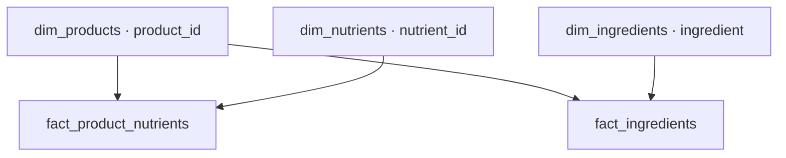

# Database and Power BI model reconstruction

This guide uses the original raw CSV as the sole product input. Choose one reconstruction route: do not restore the historical backup or cleaned CSV and then run this entire raw-input sequence over the restored tables.

## Structure and authorship

| Folder | Purpose |
|---|---|
| 00_JUHEND_JA_LOGI | Guides, author attribution, changes, test results and execution log |
| 01_ALGANDMED_JA_PUHASTUS | Raw CSV import and approved cleanup |
| 02_UHIKUD_JA_BI_SISEND | Oksana's 49 nutrient mappings and BI input |
| 03_KOOSTISOSADE_ERALDAMINE | Astrit's shared extraction algorithm |
| 04_KOOSTISOSADE_KATEGORISEERIMINE | Liina's exact-match categorization |
| 05_POWER_BI_ANDMEMUDEL | Five-table Power BI database model |
| 06_OUTLIERID | Liina's optional IQR analysis table |
| 07_LOPPKONTROLL | Required cross-stage acceptance checks |
| 90_VALIKULISED_KONTROLLID | Optional historical audits |
| 99_
Each folder has its own README. English scripts are alternatives to the corresponding default scripts, not extra steps. Data headers and values are never translated. Astrit's two original named READMEs retain his wording and structure, with only necessary factual corrections; .# Execution rules

Connect DBeaver and Python to the same target server/database. Run each entire SQL file with Execute SQL Script, stop on any error and ROLLBACK an open failed transaction. Review the SELECT outputs as well as successful completion. Re## 01 — Import and cleanup

Run the six files from 01_ALGANDMED_JA_PUHASTUS/sql, in this order, importing the CSV between the first and second files:

1. 001.01_skeemi_tabeli_loomine.sql — creates vet_analytics.vet_raw.
2. Import ../data/vetsy_nutrition_raw.csv into that empty table.
3. 001.03_impordi_kontroll.sql.
4. 001.04_vet_clean_tookoopia.sql.
5. 002.09_topeltpunktide_leidmine_parandamine.sql.
6. 003.04_mangaa_raud_jood_nihe.sql.
7. 004.01_loppkontroll.sql.

The EN/sql folder contains the equivalent English filenames and its README maps the names. Raw CSV settings: UTF-8, comma delimiter, double-quote quote character, first row is header; all 215 target columns remain TEXT. PostgreSQL truncates two long source headers at 63 bytes; inspect the parent stage README for their explicit import mappings. Expected: 15,202 unique nonblank IDs and 215 columns in each product source table. Source headers are retained.

### 02 — Oksana's normalization and vet_clean_bi

From 02_UHIKUD_JA_BI_SISEND/sql run: 00_check_vet_clean.sql → 01_create_functions.sql → 02_create_normalized_table.sql → 03_validation.sql → 04_AINULT_mg_kg.sql. Optional/05_function_checks.sql verifies 22 examples after function creation.

Expected: vet_clean_mg_kg has 15,202 rows and 264 columns, including the original 215 plus 49 numeric mg/kg columns. vet_clean_bi has 15,202 rows and 147 metadata/normalized columns, excluding raw .value/.valu/.unit fields.

Oksana's factors and source-basis assumptions remain unchanged, including the documented E IU × 1 feed-form assumption. Numeric precision is retained; no rounding to three decimal places is introduced. Unsupported units or invalid populated values remain NULL and appear in validation. The tested source has 736 populated measurement cells without a normalized result. Review them; NULL is not nutrient absence. Energy is not mg/kg.

### Python setup

Create a virtual environment in the package root and install the requirements.txt from stages 03 and 04. Both use pandas, SQLAlchemy, psycopg2-binary and python-dotenv. Copy each .env.example to .env in its respective script folder, then set DB_HOST, DB_PORT, DB_NAME, DB_USER and DB_PASSWORD to the same target database. Never commit .env.

Astrit's extraction uses DB_* settings. Liina's script additionally supports DATABASE_URL, which takes precedence; remove any stale URL or ensure it targets the same database with the postgresql+psycopg2 driver. EN categorization has a local .env when run from its subfolder; the extraction EN entry point always reads the shared parent .env.

### 03 — Astrit's extraction

Run 003_preflight.sql → product_extract.py → 004_validation.sql in 03_KOOSTISOSADE_ERALDAMINE. The Python reads vet_clean_mg_kg from PostgreSQL and creates product_ingredients_rows with _id, product_name_fi, product_name_en and ingredient. It does not read CSV. EN/product_extract.py runs the same shared algorithm.

Require OUTPUT COMMITTED and validate blanks, missing source IDs and duplicate product/ingredient pairs. Expected regenerated output for this input is 86,264 rows covering 8,644 products. Replacement is transactional. Products with no extracted ingredients require review.

### 04 — Liina's categorization

Run 00_create_reference_table.sql, then import categories_reference.csv into vet_analytics.ingredients_categories_reference. CSV settings: UTF-8, **semicolon** delimiter, header row, all seven columns TEXT. Headers are Ingredient, Category, Human Review, Review Reason, Protein, Oil, Carbs. Import once into the empty target; expected 6,759 rows.

Run fact_ingredients_loomine.sql → kategoriseerimine2.py → 03_validation.sql. Output is directly vet_powerbi.fact_ingredients, with product_id, ingredient, category, protein, oil and carbs. It is not created in vet_analytics or moved later. Original matching rules are retained; conflicting usable duplicate reference values now stop before writing.

Expected: 64,123 categorized rows covering 8,325 products. 22,141 extracted ingredient rows have no usable categorized match. This limitation must be retained in BI interpretation; missing categories do not establish ingredient absence or allergy safety. Human Review is retained in the reference but is not an automatic exclusion filter in the original matching rules.

### 05 — Power BI database model

Run 001_loo_schema.sql → 002_loo_vet_powerbi_mudel.sql → 003_taienda_dim_ingredients.sql → 004_kontrolli_mudelit.sql. Stage 04 must already be complete. The model reads vet_clean_bi and the existing vet_powerbi.fact_ingredients. It creates four remaining tables without replacing, moving or renaming the ingredient fact.

| Table | Expected rows |
|---|---:|
| dim_products | 15,202 |
| dim_nutrients | 49 |
| fact_product_nutrients | 744,898 |
| dim_ingredients | 3,327 |
| fact_ingredients | 64,123 |

Product display name uses FI → EN → ID. Source name fields remain unchanged. The ingredient dimension category is filled from unambiguous fact categories; existing manual values are preserved on enrichment. Resolve conflicts before acceptance. Creation refuses an existing model; it is not a general refresh script.

### 06 and 07 — Analysis and acceptance

06_OUTLIERID/01_outliers.sql is optional for the five BI tables but required if you want to recreate vet_analytics.outliers. It retains Liina's 49 nutrient and 2 energy indicators and 1.5 × IQR rules, excludes NULL/zero, derives a valid display name and replaces the results within BEGIN/COMMIT. Expected result: 20,744 HIGH_OUTLIER rows; no LOW_OUTLIER rows in this source. Flags were verified against their bounds; this is not proof that flagged source values are erroneous.

Always run 07_LOPPKONTROLL/01_loppkontroll.sql after stages 01–05. It checks source counts, keys, categories, duplicates and the exact values of all 49 indicators across normalized source, BI input and nutrient fact, including NULLs and small numeric values. Record the output and unmatched ingredient count.

## Power BI Desktop

Import exactly the five vet_powerbi tables from the restored target database. Set four active Single-direction relationships, dimensions on the 1 side and facts on the * side:

| Dimension key | Fact key |
|---|---|
| dim_products[product_id] | fact_product_nutrients[product_id] |
| dim_nutrients[nutrient_id] | fact_product_nutrients[nutrient_id] |
| dim_products[product_id] | fact_ingredients[product_id] |
| dim_ingredients[ingredient] | fact_ingredients[ingredient] |

Selecting the fact first shows *:1; this is the same relationship. Do not connect facts to each other. Product/ingredient keys are text, nutrient_id is an integer and value_mg_kg is a decimal. Ingredient-category filters do not automatically propagate backwards to dim_products or the nutrient fact with Single direction. Restore the report's existing measures and visual filters from PBIX/PBIP. The package does not change earlier DAX.

Check Power Query Source, Data source settings, query names and columns, Apply changes and Refresh. Verify a selected product, ingredient list, nutrient value and category-filtered product list. The separate SQL test did not execute Power BI or DBeaver's import UI.

For later categorization-only changes: refresh the reference → stage 04 Python → 05/003 → 05/004 → 07 → BI Refresh. When product source data changes, rebuild all affected snapshots; rebuilding vet_clean_bi alone does not refresh the existing BI dimensions/facts. Optional 90 audits and archived 99 scripts are not mandatory continuation steps.
