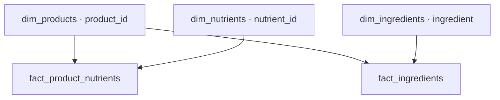

# Power BI

Allikas `vet_analytics.vet_clean_bi`; lõppskeem `vet_powerbi`. Liina skript loob koostisosafakti kohe `vet_powerbi` skeemi. Mudeliskript ei liigu enam vana `vet_analytics.fact_ingredients` kaudu. Koostisosade ainus lõppfakt on `fact_ingredients`, võtmega `product_id`. Käivitusjärjekord on juurkausta README-s: etapp 04: fakti loomine ja kategoriseerimine → etapp 05: skeem → mudel → dimensiooni täiendamine → kontroll → Power BI import.

## Viis tabelit

| Tabel | Ühe rea tähendus | Olulised väljad |
|---|---|---|
| dim_products | Üks toode | product_id ja allika lubatud tooteatribuudid |
| dim_nutrients | Üks _mg_kg lähteveerus olev näitaja | nutrient_id, nutrient_name, unit |
| fact_product_nutrients | Ühe toote ühe näitaja väärtus | product_id, nutrient_id, value_mg_kg |
| dim_ingredients | Üks koostisosanimi | ingredient, category |
| fact_ingredients | Toote kategoriseeritud koostisosa | product_id, ingredient, category, protein, oil, carbs |

`dim_products.product_name` tuletatakse FI → EN → ID järjestuses; allika nimed säilivad eraldi. Mudelis ei ole `fact_product_ingredients` ega `ingredient_id` lisavõtit. Faktil on tänase Pythoniga samad kuus väljundveergu. Koostisosad seotakse nime järgi.

## Import ja neli seost

Power BI Desktop → Get data → PostgreSQL database → sisesta sihtserver (vajadusel host:port) ja andmebaasinimi → Import → vali **need viis tabelit** skeemist `vet_powerbi`. Kui küsitakse, kasuta sihtbaasi PostgreSQL-i kasutajat ja parooli. Värske backup'i järel kontrolli samuti Data source settings ja Power Query Source sammu.

| Dimensiooni 1-pool | Fakti *-pool | Aktiivsus ja suund |
|---|---|---|
| dim_products[product_id] | fact_product_nutrients[product_id] | Active, Single |
| dim_nutrients[nutrient_id] | fact_product_nutrients[nutrient_id] | Active, Single |
| dim_products[product_id] | fact_ingredients[product_id] | Active, Single |
| dim_ingredients[ingredient] | fact_ingredients[ingredient] | Active, Single |

Kui dialoogis valitakse fakt esimesena, on kardinaalsus `*:1`; dimensioon esimesena `1:*`. Mõlemad kirjeldavad sama seost. Oluline on kordumatu võti dimensiooni poolel ja Single filtreerimine dimensioonist fakti. Faktitabeleid omavahel ei ühendata.

`product_id` ja `ingredient` peavad olema tekstina. `nutrient_id` on täisarv; `value_mg_kg` Decimal number. Sisaldusi eri toodete vahel ei summeerita vaikimisi: kasuta sobivat keskmist, miinimumi või maksimumi ja ühte näitajat korraga.

Kategooriaslicer kasuta `dim_ingredients[category]`. Single-seos filtreerib koostisosafakti; see ei kanna filtrit automaatselt tagasi toodete dimensiooni ja toitainete fakti. Seetõttu ei ole ainult SQL-pakett kogu sinu BI aruande taasesitus: olemasolevate mõõdikute/filtrite/slicerite jaoks on vaja `.pbix` või `.pbip` projekti. Siin ei muudeta varem kasutatud `Toote_Koostisosa_Filter` DAX-i.

Dimensioonile kategooriate lisamisel uuenda Power Query eelvaadet, rakenda muudatused ning tee raporti Refresh. Kontrolli, et päringute ja seoste veerunimed ei kasutaks enam vana `_id` fakti võtmena.

