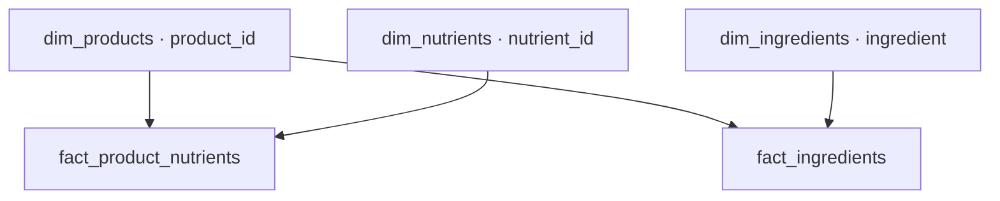

# 05. Power BI model

Use the complete English guide in ../00_JUHEND_JA_LOGI/README_EN.md. After stage 04 categorization, run 001_loo_schema.sql → 002_loo_vet_powerbi_mudel.sql → 003_taienda_dim_ingredients.sql → 004_kontrolli_mudelit.sql.

The model consumes vet_analytics.vet_clean_bi and the existing vet_powerbi.fact_ingredients. Four remaining tables are created; the six-column ingredient fact is preserved. The five tables and expected counts are in the parent README. The diagram is retained:

Set four active 1:* Single relationships from dimensions to facts. Existing manual ingredient categories are preserved by enrichment; solve any fact/dimension conflicts before stage 07. SQL reconstruction does not recreate PBIX/PBIP, DAX or report visuals. Creation refuses an existing model; follow the full guide for updates.
