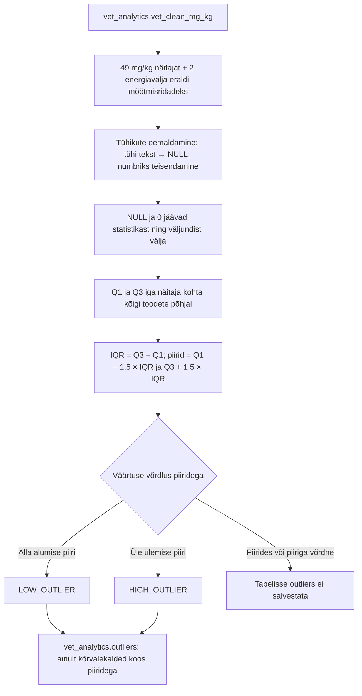
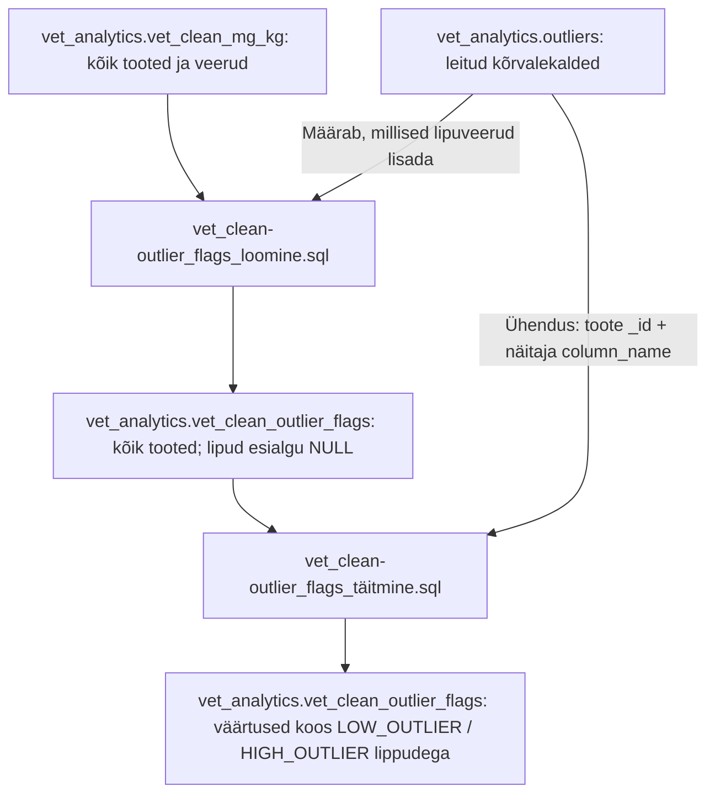

# Toitainete kõrvalekallete leidmine — Liina SQL

## 1. Eesmärk

SQL leiab statistiliselt ebatavaliselt madalad või kõrged väärtused **1,5 × IQR** meetodil. Koodi autor on **Liina**. **05.10.2026** uuendus ühtlustab kommentaarid ja dokumentatsiooni; 49 toitaine, 2 energia näitaja ja IQR reeglid säilivad. Taastamisel lisati FI→EN nimeavaldis ja tehinguline kirjutamine.

Aluseks on sisendfail `outliersite_leidmine (1).sql`. 

## 2. Failid ja koht taastamisjuhendis

| Fail | Otstarve |
| --- | --- |
| `01_outliers.sql` | Liina IQR-analüüs: loob ainult kõrvalekaldeid sisaldava tabeli `outliers` |
| `vet_clean-outlier_flags_loomine.sql` | Kopeerib kõik normaliseeritud tooted tabelisse `vet_clean_outlier_flags` ja lisab tühjad lipuveerud |
| `vet_clean-outlier_flags_täitmine.sql` | Täidab loodud lipuveerud tabeli `outliers` tulemustega |
| `README_EN.md` | Ingliskeelne juhend |
| `README.md` | Eestikeelne juhend |


## 3. Eeldused ja käivitamise järjekord

Kasuta PostgreSQL-i ja DBeaverit. Skeem `vet_analytics` ning andmetega tabel `vet_clean` peavad juba olemas olema. Käivitajal peab olema sisendi lugemisõigus ning tulemuste tabeli loomise ja kustutamise õigus.

1. Taasta/impordi ja puhasta tooted tabelisse `vet_analytics.vet_clean`.
2. Käivita `../02_UHIKUD_JA_BI_SISEND/sql/01_create_functions.sql`.
3. Käivita `../02_UHIKUD_JA_BI_SISEND/sql/02_create_normalized_table.sql`.
4. Käivita `../02_UHIKUD_JA_BI_SISEND/sql/03_validation.sql` ja vaata kontrolli tulemusi.
5. Ava DBeaveris `01_outliers.sql` ja käivita kogu skript.
6. Kontrolli tabelit `outliers` punkti 9 päringutega.
7. Käivita kogu fail `vet_clean-outlier_flags_loomine.sql`. See loob tabeli `vet_analytics.vet_clean_outlier_flags`; lipud on esialgu tühjad.
8. Käivita kogu fail `vet_clean-outlier_flags_täitmine.sql`. See täidab lipud.
9. Värskenda skeemis `vet_analytics` kausta Tables ning kontrolli lõpptabelit punkti 15 päringutega.

Eelduste failinimed on loogilised nimed; duplikaaditähis `(1)` allalaaditud failinimes järjekorda ei muuda.

## 4. Sisend ja väljund

Sisend: **`vet_analytics.vet_clean_mg_kg`**. Olemasolev teisendusskript säilitab `v.*` abil algsed veerud ning lisab 49 numbrilist `_mg_kg` veergu. Kõik 49 kattuvad Liina SQL-i viidetega.

`01_outliers.sql` väljund: **`vet_analytics.outliers`**, füüsiline tabel, milles on **ainult kõrvalekalded**. Olemasolev samanimeline tabel kustutatakse ja luuakse uuesti. Tabeleid `vet_clean` ja `vet_clean_mg_kg` ei muudeta. Vaateid ega uusi funktsioone see skript ei loo.

Allika `_id` ja `product_name_en` säilivad. Väljundi `product_name` tuletatakse FI nimest, selle puudumisel EN nimest ning mõlema puudumisel ID-st. Algsel 215-veerulisel CSV-l `product_name` veergu pole; see viide põhjustas taastamisel vea. Allika päiseid ei muudeta.

## 5. Analüüsitavad näitajad

Koodis on **51 näitajat: 49 normaliseeritud toitainet ja 2 energiavälja**. Algne loend, järjekord, avaldised ja kirjapilt säilivad.

49 normaliseeritud veergu on:

`crude_protein_mg_kg`, `digestible_protein_from_aa_mg_kg`, `crude_fat_mg_kg`, `crude_fibre_mg_kg`, `ash_mg_kg`, `vitamin_a_mg_kg`, `vitamin_b1_mg_kg`, `vitamin_b2_mg_kg`, `vitamin_b6_mg_kg`, `vitamin_b12_mg_kg`, `vitamin_d3_mg_kg`, `vitamin_e_mg_kg`, `pantothenic_acid_mg_kg`, `niacin_mg_kg`, `folic_acid_mg_kg`, `biotin_mg_kg`, `vitamin_c_mg_kg`, `vitamin_k_mg_kg`, `fatty_acids_linoleic_acid_mg_kg`, `vitamins_linoleic_acid_mg_kg`, `iron_mg_kg`, `zinc_mg_kg`, `copper_mg_kg`, `copper_sulfate_mg_kg`, `calsium_mg_kg`, `phosphorous_mg_kg`, `magnesium_mg_kg`, `sodium_mg_kg`, `potassium_mg_kg`, `iodine_mg_kg`, `manganese_mg_kg`, `selenium_mg_kg`, `cobalt_mg_kg`, `natrium_mg_kg`, `lysine_mg_kg`, `methionine_mg_kg`, `taurine_mg_kg`, `arginine_mg_kg`, `isoleucine_mg_kg`, `leucine_mg_kg`, `cystine_mg_kg`, `phenylalanine_mg_kg`, `tyrosine_mg_kg`, `threonine_mg_kg`, `tryptophan_mg_kg`, `valine_mg_kg`, `histidine_mg_kg`, `choline_mg_kg`, `nfe_mg_kg`.

`calsium_mg_kg` on olemasoleva teisendusskripti kirjapilt. `sodium_mg_kg` ja `natrium_mg_kg`, samuti kaks linoolhappe välja, jäävad eraldi näitajateks. Veerge ei nimetata ümber ega ühendata.

| Energia tähis | Sisendveerg | Tõlgendamine |
| --- | --- | --- |
| `convertible_energy` | `"convertible_energy.value.1"` | Algne energiaväli; kontrolli sisendi välja `"convertible_energy.unit_kJ"` |
| `ME_kcal` | `"ME (kcal)"` | Algne kcal-tähisega väli; mg/kg-teisendust ei tehta |

Iga näitajat võrreldakse ainult sama näitajaga. Energiat ei võrrelda toitainetega ning kahte energiavälja ei ühendata. Samas ei kontrolli SQL ühikute ühtsust ühe energiavälja sees. **28. septembri ekspordis** on täidetud `convertible_energy.value.1` väärtuste kõrval väljas `convertible_energy.unit_kJ` 513 märget `kJ` ja 588 märget `mg`. Enne selle välja kõrvalekallete sisulist hindamist tuleb märgete tähendus kontrollida. Praeguses andmebaasis võivad olla hilisemad parandused. Selle uuendusega uut energia teisendus- ega filtreerimisreeglit ei oletatud.

## 6. Töötlemise sammud

`measurements` muudab `CROSS JOIN LATERAL ... VALUES` abil laiad näitajaveerud ridadeks: iga toote ja näitaja kohta tekib üks rida.

Iga avaldis säilitab kuju `NULLIF(TRIM(value::text), '')::numeric`: väärtus muudetakse tekstiks, eemaldatakse äärmised tühikud, tühi tekst muutub NULL-iks ning tulemus teisendatakse numbriks. Avaldis ei paranda kümnendkomasid ega suvalist vigast teksti. Toitainete teisendamine toimub eelnevas normaliseerimissammus. Vigane mittetühi tekst energiaväljas võib skripti katkestada; kontrollitud septembri ekspordi energiaväljadest selliseid väärtusi ei leitud.

`statistics` arvutab iga `column_name` kohta Q1 ja Q3 funktsioonidega `PERCENTILE_CONT(0.25)` ja `PERCENTILE_CONT(0.75)`. NULL ja arv 0 jäävad kvartiilide arvutusest välja. Lõpppäring ühendab mõõtmised vastava näitaja statistikaga ning salvestab ainult piiridest väljapoole jäävad väärtused.

## 7. Statistilised reeglid

- Q1: esimene kvartiil ehk 25. protsentiil.
- Q3: kolmas kvartiil ehk 75. protsentiil.
- IQR: `Q3 - Q1`, keskmise 50% väärtuste hajuvus.
- Alumine piir: `Q1 - 1,5 × IQR`.
- Ülemine piir: `Q3 + 1,5 × IQR`.
- Väärtus alla alumise piiri: `LOW_OUTLIER`.
- Väärtus üle ülemise piiri: `HIGH_OUTLIER`.

Piiriga võrdne väärtus kõrvalekalle ei ole. NULL ja 0 jäävad välja nii statistikast kui ka väljundist. Negatiivsed nullist erinevad väärtused osalevad nagu algses SQL-is; eraldi negatiivse väärtuse lippu ei ole. Alumine piir võib olla negatiivne ning seda **ei piirata nulliga**. 


Valimi minimaalse suuruse reeglit ega loomaliigi või tootetüübi kaupa gruppe ei lisata. Võrdlus toimub kõigi toodete vahel iga näitaja piires. Kõrvalekalle on kontrollimist vajav kandidaat, mitte tõend andmeveast, toitainete puudusest ega toidu sobimatusest. Märgistamata väärtusi ei saa automaatselt korrektseks lugeda.

## 8. Väljundveerud

| Veerg | Tähendus |
| --- | --- |
| `_id` | Algne toote identifikaator |
| `product_name` | FI nimi → EN nimi → ID |
| `product_name_en` | Olemasolev ingliskeelne tootenimi |
| `column_name` | Näitaja nimi; 49 toitaine nime lõpevad `_mg_kg` |
| `value` | Normaliseeritud toitainesisaldus või algne energiaväärtus |
| `q1` | Esimene kvartiil ehk 25. protsentiil |
| `q3` | Kolmas kvartiil ehk 75. protsentiil |
| `iqr` | `q3 - q1` |
| `lower_bound` | `q1 - 1.5 × iqr` |
| `upper_bound` | `q3 + 1.5 × iqr` |
| `flag` | `LOW_OUTLIER` / `HIGH_OUTLIER` |

Toitainete väärtused ja piirid on mg/kg. Energiaväärtused ja piirid on vastava algvälja skaalal. Väljundis pole `unit` veergu; kõiki tulemusi ei tohi tähistada mg/kg-na.

## 9. Kontrollpäringud

Päring kinnitab tabeli olemasolu ja loendab salvestatud kõrvalekalded. Tulemuste arv ei pea võrduma toodete arvuga: ühel tootel võib olla mitu kõrvalekallet või mitte ühtegi.

```sql
-- Loenda tulemuste tabelisse salvestatud kõrvalekalded.
SELECT COUNT(*) AS outlier_rows
FROM vet_analytics.outliers;
```

Päring näitab iga näitaja ja lipu ridade arvu. Esineda peaksid ainult `LOW_OUTLIER` ja `HIGH_OUTLIER`.

```sql
-- Võrdle kõrvalekallete arvu näitajate ja lippude kaupa.
SELECT column_name, flag, COUNT(*) AS row_count
FROM vet_analytics.outliers
GROUP BY column_name, flag
ORDER BY column_name, flag;
```

Päring kuvab tulemused Liina loomispäringuga samas loogilises järjestuses. Füüsilist tabelit lugedes tuleb järjestus määrata eraldi.

```sql
-- Vaata väärtusi koos arvutatud piiridega.
SELECT *
FROM vet_analytics.outliers
ORDER BY column_name, value DESC;
```

Päring näitab, kas sisendi ridade arv vastab endiselt projekti lähtearvule. Kontrollitud septembri ekspordis oli 15 202 rida; praeguse andmebaasi arv tuleb eraldi kontrollida.

```sql
-- Kontrolli normaliseeritud sisendtabeli praegust suurust.
SELECT COUNT(*) AS source_rows
FROM vet_analytics.vet_clean_mg_kg;
```

## 10. Korduskäivitamine

Tulemuste tabel on **hetkeseisu väljavõte**, mitte automaatselt uuenev vaade. Pärast sisendandmete muutmist või normaliseeritud tabeli taasloomist käivita `01_outliers.sql` ning seejärel mõlemad lipuskriptid uuesti selles järjekorras (vt punkt 16). Eelmine väljund kustutatakse ja luuakse uus tabel; vanu tulemusi juurde ei liideta.

`CREATE TABLE ... AS SELECT` abil loodud füüsilisel tabelil pole sisendiga vaatele omast püsivat sõltuvust. Uusi indekseid, võtmeid ega õigusi ei lisatud; tulemuse asendamisele lisati BEGIN/COMMIT. Kui olemasolevast väljundist sõltuvad muud objektid või sellele on käsitsi lisatud omadusi, tuleb neid enne kustutamist arvestada. CASCADE-i ei lisatud.

## 11. Kontroll ja käivituslogi

Kõik 49 normaliseeritud veeru viidet kontrolliti olemasoleva teisendusskripti vastu ning toote- ja energiaväljad projekti ekspordi päise vastu. Värske muudatus on kirjeldatud ühises töölogis: tootenime avaldis ja BEGIN/COMMIT lisamine. Statistilised avaldised säilivad.


## 12. Uus kood: liputabeli loomine

Fail **`vet_clean-outlier_flags_loomine.sql`** teeb kõrvalekalded nähtavaks toote andmete kõrval. Tabelis `outliers` on iga kõrvalekalle eraldi real; uus tabel **`vet_analytics.vet_clean_outlier_flags`** sisaldab kõiki sisendtabeli tooteridu ja kõiki selle veerge, sealhulgas tooteid, millel kõrvalekaldeid ei leitud.

Sisendid on `vet_analytics.vet_clean_mg_kg` ja eelnevalt loodud `vet_analytics.outliers`. Skript:

1. Kustutab olemasoleva tabeli `vet_clean_outlier_flags`, kui see on olemas.
2. Loeb sisendtabeli veerunimed ja järjekorra `information_schema.columns` kaudu.
3. Lisab iga algse veeru tulemusse muutmata kujul.
4. Kui näitaja kohta leidub tabelis `outliers` vähemalt üks rida, lisab kohe selle väärtuseveeru järele tekstilise lipuveeru.
5. Kopeerib kõik sisendtabeli read uude füüsilisse tabelisse. Kõik lipud on selles etapis `NULL` ehk tühjad.

**Lipuveerud sõltuvad tulemustest.** Kõigile 51 näitajale ei teki automaatselt lipuveergu. Kui näiteks `vitamin_a_mg_kg` kohta ei leidu ühtegi kõrvalekallet, siis selle jooksu väljundis pole ka `vitamin_a_mg_kg_flag` veergu. Kui tabel `outliers` on olemas, kuid tühi, luuakse kõigi toodete koopia ilma lipuveergudeta. Kui `outliers` puudub, skript ebaõnnestub.

| Sisendi väärtuseveerg | Näitaja nimi tabelis `outliers` | Loodava lipuveeru nimi |
| --- | --- | --- |
| `vitamin_a_mg_kg` | `vitamin_a_mg_kg` | `vitamin_a_mg_kg_flag` |
| Muud `_mg_kg` näitajad | Sama nimi mis väärtuseveerul | Väärtuseveeru nimi + `_flag` |
| `convertible_energy.value.1` | `convertible_energy` | `convertible_energy_flag` |
| `ME (kcal)` | `ME_kcal` | `ME_kcal_flag` |

Energiaväljadele kasutatakse eraldi nimevastavusi, sest nende algsed veerunimed ja `outliers.column_name` väärtused erinevad. Liputabel ei teisenda ühikuid ega arvuta uuesti IQR-piire. `CREATE TABLE ... AS SELECT` kopeerib veerud ja andmed, kuid ei kopeeri sisendtabeli indekseid, võtmeid ega muid piiranguid.

## 13. Uus kood: lipuveergude täitmine

Fail **`vet_clean-outlier_flags_täitmine.sql`** kannab juba leitud kõrvalekallete märgised liputabelisse. Enne käivitamist peavad olemas olema nii `outliers` kui ka eelmise skriptiga loodud `vet_clean_outlier_flags`. Käivitajal peab olema `outliers` lugemisõigus ja liputabeli uuendamise õigus.

Skript loeb tabelist `outliers` erinevad näitajanimed, leiab iga näitaja lipuveeru nime ning uuendab vastavat veergu. Sobivus leitakse **toote `_id` ja näitaja `column_name` järgi**. Väärtuseks kopeeritakse `outliers.flag`: `LOW_OUTLIER` või `HIGH_OUTLIER`.

Toote nimi ei ole ühendamise alus. Skript ei muuda toitainete väärtusi, ei eemalda tooteid ega arvuta uusi kõrvalekaldeid. Ühel tootel võib täituda mitu lipuveergu. Tootel, mille kohta vastavat kõrvalekallet ei leitud, jääb lipp tühjaks.

Eeldus on, et sisendis identifitseerib `_id` üheselt toote ning tabelis `outliers` on sama `_id` ja `column_name` paari kohta kõige rohkem üks rida. Skriptid ise seda võtmetega ei taga; punkti 15 kontrollid aitavad probleemi märgata.

## 14. Kuidas lõpptabelit lugeda?

Ava DBeaveris `vet_analytics` → Tables → `vet_clean_outlier_flags` → Data. Vaata näitaja väärtust ja kohe selle järel olevat `_flag` veergu.

| Lipu väärtus | Tähendus |
| --- | --- |
| `LOW_OUTLIER` | Selle toote väärtus on näitaja arvutatud alumisest IQR-piirist väiksem |
| `HIGH_OUTLIER` | Selle toote väärtus on näitaja arvutatud ülemisest IQR-piirist suurem |
| `NULL` / tühi | Selle toote ja näitaja kohta ei kantud kõrvalekalde märgist tabelist `outliers` |
| Lipuveerg puudub | Selle näitaja kohta ei olnud loomise hetkel tabelis `outliers` ühtegi kõrvalekallet |

**Tühi lipp ei tähenda automaatselt korrektset väärtust.** See võib tähendada piiridesse jäävat väärtust, puuduvat väärtust või nulli, mis jäeti IQR-analüüsist välja. Ka lipuveeru puudumine ei kinnita andmete õigsust.

Näide (näitlikud arvud, mitte selle andmebaasi tulemus): kui `vitamin_a_mg_kg = 20` ja `vitamin_a_mg_kg_flag = HIGH_OUTLIER`, on väärtus 20 mg/kg üle selle näitaja arvutatud ülemise piiri. Konkreetseid piire ja kvartiile vaata tabelist `outliers`: liputabelisse neid ei lisata.

| Tabel | Milleks kasutada? |
| --- | --- |
| `vet_clean_mg_kg` | Normaliseeritud andmete alus |
| `outliers` | Kõrvalekallete üksikasjad: näitaja, väärtus, Q1, Q3, IQR, piirid ja lipp |
| `vet_clean_outlier_flags` | Kõik tooted koos väärtuste kõrvale lisatud lippudega |

Power BI-s sobib liputabel toote andmete ja andmekvaliteedi märgiste koos näitamiseks; `outliers` sobib kõrvalekallete kokkuvõteteks näitajate kaupa. Need kaks uut skripti ei loo ega uuenda `vet_clean_bi` tabelit või skeemi `vet_powerbi`. Olemasoleva BI mudeliga ühendamine on eraldi samm. Kuna lipuveerud võivad jooksuti muutuda, kontrolli pärast taasloomist nende olemasolu ka neid kasutavates Power Query sammudes ja visualiseeringutes.

## 15. Uute sammude kontrollpäringud

See päring võrdleb normaliseeritud sisendi ja liputabeli ridade arvu. Vahetult pärast loomist peavad arvud olema võrdsed; loomisskript ei filtreeri tooteid välja.

```sql
-- Võrdle sisendi ja loodud liputabeli ridade arvu.
SELECT
    (SELECT COUNT(*) FROM vet_analytics.vet_clean_mg_kg) AS source_rows,
    (SELECT COUNT(*) FROM vet_analytics.vet_clean_outlier_flags) AS flag_table_rows;
```

See päring näitab tegelikult loodud lipuveerge nende tabelijärjekorras. Null rida on võimalik, kui analüüs ei leidnud ühtegi kõrvalekallet.

```sql
-- Loetle selle jooksu lipuveerud.
SELECT column_name, ordinal_position
FROM information_schema.columns
WHERE table_schema = 'vet_analytics'
  AND table_name = 'vet_clean_outlier_flags'
  AND RIGHT(column_name, 5) = '_flag'
ORDER BY ordinal_position;
```

See päring kontrollib puuduvaid ja korduvaid tooteidentifikaatoreid. Oodatav tulemus on tühi; enne lippude tõlgendamist uuri leitud ridu.

```sql
-- Leia puuduvad või mitteunikaalsed toote ID-d sisendist.
SELECT "_id", COUNT(*) AS row_count
FROM vet_analytics.vet_clean_mg_kg
GROUP BY "_id"
HAVING "_id" IS NULL OR BTRIM("_id"::text) = '' OR COUNT(*) > 1;
```

See päring kontrollib, et sama toote ja näitaja kohta poleks mitut kõrvalekalderida. Oodatav tulemus on tühi.

```sql
-- Leia korduvad toote ja näitaja paarid kõrvalekallete tabelis.
SELECT "_id", column_name, COUNT(*) AS row_count
FROM vet_analytics.outliers
GROUP BY "_id", column_name
HAVING COUNT(*) > 1;
```

Järgmine päring võrdleb kõiki `outliers` ridu liputabelisse kantud märgistega. `missing_or_different_flags` peab pärast mõlema uue skripti edukat käivitamist olema 0. Päring kasutab `to_jsonb(v)` ainult kontrollimiseks, et saaks lugeda eri nimega lipuveerge ühes päringus; see ei muuda tabeleid ega salvesta JSON-andmeid.

```sql
-- Kontrolli, et iga leitud kõrvalekalde lipp oleks lõpptabelisse kantud.
SELECT
    COUNT(*) AS checked_outlier_rows,
    COUNT(*) FILTER (
        WHERE (to_jsonb(v) ->> CASE
            WHEN o.column_name = 'convertible_energy' THEN 'convertible_energy_flag'
            WHEN o.column_name = 'ME_kcal' THEN 'ME_kcal_flag'
            ELSE o.column_name || '_flag'
        END) IS DISTINCT FROM o.flag
    ) AS missing_or_different_flags
FROM vet_analytics.outliers o
LEFT JOIN vet_analytics.vet_clean_outlier_flags v ON v."_id" = o."_id";
```

## 16. Korduskäivitamine ja muudatuste logi

Pärast sisendi muutmist või uuesti normaliseerimist käivita alati järjest:

1. `01_outliers.sql` — arvutab kõrvalekalded uuest sisendist.
2. `vet_clean-outlier_flags_loomine.sql` — loob värske tooteandmete koopia ja tühjad lipud.
3. `vet_clean-outlier_flags_täitmine.sql` — kannab värsked märgised lõpptabelisse.

**Ainult täitmisskripti kordamine ei värskenda kogu tulemust.** See ei tühjenda vanu lippe, ei kopeeri muudetud väärtusi ega lisa uusi lipuveerge. Kui varasem kõrvalekalle uues analüüsis kaob, võib ainult täitmise kordamisel vana lipp alles jääda. Loomisskript eemaldab need vanad märgised, kuid pärast loomist tuleb täitmisskript uuesti käivitada.

Erinevalt `01_outliers.sql` failist ei sisalda loomisskript eraldi BEGIN/COMMIT ümbrist: `DROP TABLE` on enne `DO` plokki. DBeaveri automaatse kinnitamise korral ei pruugi loomise ebaõnnestumisel eelmine liputabel säilida. Mõlemad uued skriptid töötlevad tuletatud liputabelit; sisendit ja tabelit `outliers` ei muudeta.


## 17. Protsessi joonis

Joonis järgib kaasasolevaid kolme SQL-faili. Esimene osa näitab IQR-analüüsi; teine näitab tulemuste lisamist kõigi toodete andmete kõrvale.

### 17.1. Kõrvalekallete leidmine — `01_outliers.sql`



Alumist piiri ei piirata nulliga: kaasasolev kood kasutab täpselt valemit `Q1 − 1,5 × IQR`. Negatiivsed nullist erinevad sisendväärtused osalevad analüüsis. IQR-lipp näitab statistiliselt ebatavalist väärtust, mitte kinnitatud andmeviga. Energia ühikuid selles etapis ei ühtlustata.

### 17.2. Kõigi toodete tabel koos lippudega



Tabelisse jäävad ka ilma kõrvalekalleteta tooted. Lipu puudumise tähendust selgitab punkt 14. 
