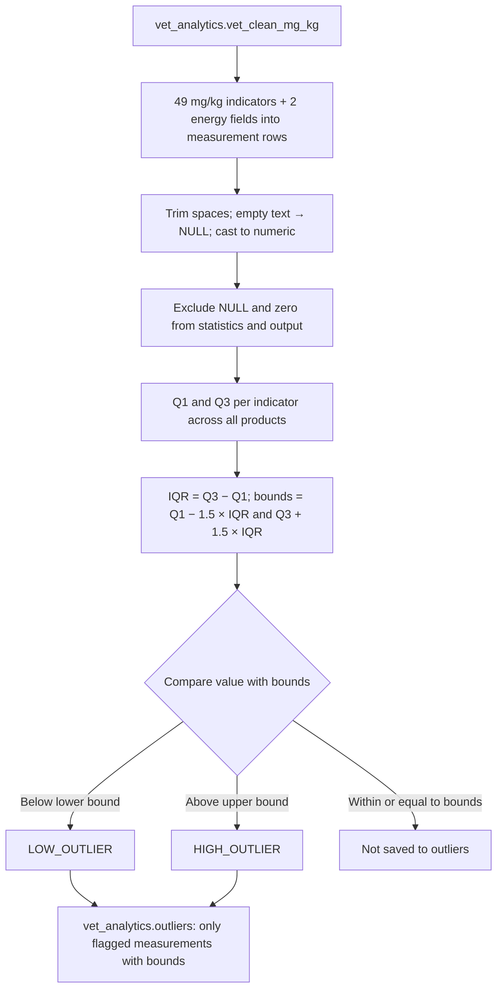
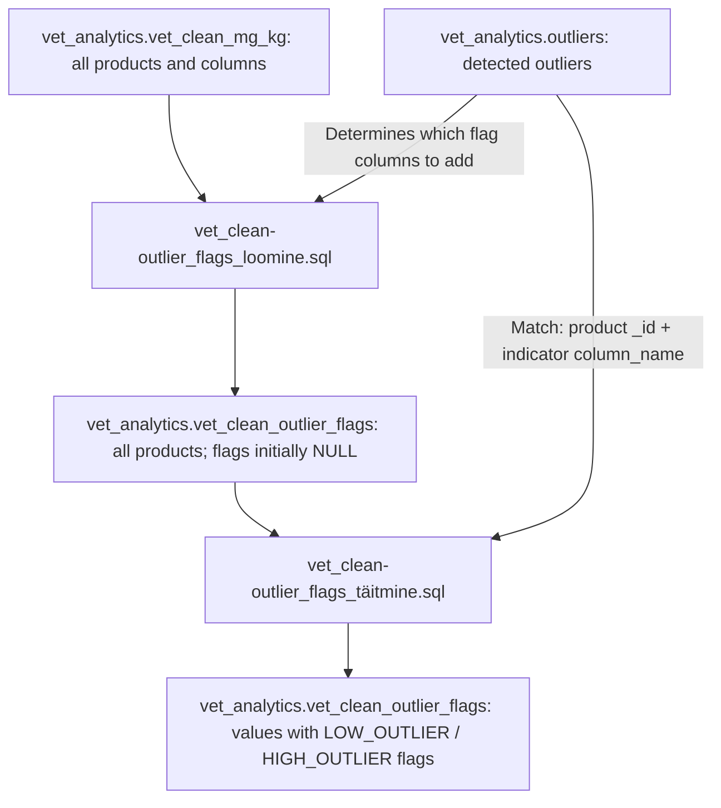

> Integration correction 2026-10-05: source `product_name` does not exist in the raw CSV. The output display name now uses FI → EN → ID, without altering source headers. BEGIN/COMMIT protects the previous outliers table from partial replacement. All 51 indicators and IQR expressions are retained. Separate test-database execution results are in `../00_JUHEND_JA_LOGI/TESTIMISE_TULEMUSED.md`. Historical unchanged-SQL claims below apply to the earlier review, not this correction.

# Nutrient outlier detection — Liina's SQL

## 1. Purpose

The SQL identifies unusually low or high values using the **1.5 × IQR** method. The original author is **Liina**. The update dated **2026-10-05** retains the 51 indicators and IQR rules, corrects the source display-name reference and makes replacement transactional.

The corrected source file is `outliersite_leidmine (1).sql`. The earlier `liina_anomaaliate_leidmine2.sql` is not the basis of this package.

## 2. Files and restoration workflow

| File | Purpose |
| --- | --- |
| `01_outliers.sql` | Liina's IQR analysis: creates `outliers`, containing only flagged measurements |
| `vet_clean-outlier_flags_loomine.sql` | Copies all normalized products into `vet_clean_outlier_flags` and adds empty flag columns |
| `vet_clean-outlier_flags_täitmine.sql` | Populates the flag columns using the results in `outliers` |
| `README_EN.md` | English instructions |
| `README.md` | Estonian instructions |
| `CHANGELOG_Liina_outliers_EN.md` | English change log |
| `CHANGELOG_Liina_outliers_ET.md` | Estonian change log |

Add this section to `andmebaasi_taastamine_nullist` after nutrient normalization and validation. It creates a derived analysis table; it does not import products or create the Power BI star schema. No Python, CSV import or external files are required to run this step.

## 3. Prerequisites and order

Use PostgreSQL and DBeaver. The `vet_analytics` schema and populated `vet_clean` table must already exist. The executing user needs SELECT permission on the input and rights to create/drop the derived results table.

1. Restore/import and clean the products into `vet_analytics.vet_clean`.
2. Run `../02_UHIKUD_JA_BI_SISEND/sql/01_create_functions.sql`.
3. Run `../02_UHIKUD_JA_BI_SISEND/sql/02_create_normalized_table.sql`.
4. Run `../02_UHIKUD_JA_BI_SISEND/sql/03_validation.sql` and review the results.
5. Open `01_outliers.sql` in DBeaver and execute the whole script.
6. Inspect `outliers` using section 9.
7. Execute the whole `vet_clean-outlier_flags_loomine.sql` file. It creates `vet_analytics.vet_clean_outlier_flags`; flags are initially empty.
8. Execute the whole `vet_clean-outlier_flags_täitmine.sql` file to populate the flags.
9. Refresh `vet_analytics` → Tables and verify the final table using section 15.

The prerequisite names are the logical filenames; duplicate download suffixes such as `(1)` do not change the order.

## 4. Input and output

Input: **`vet_analytics.vet_clean_mg_kg`**. The existing normalization script uses `v.*` to retain the source fields and creates 49 numeric `_mg_kg` columns. All 49 match the references in Liina's SQL.

Output of `01_outliers.sql`: **`vet_analytics.outliers`**, a physical table containing **only outlier rows**. An existing table of the same name is dropped and recreated. Neither `vet_clean` nor `vet_clean_mg_kg` is modified. This SQL creates no view or extra function.

Source fields `_id` and `product_name_en` are retained. Output product_name is derived from product_name_fi, then product_name_en, then _id. The 215-column source has no product_name column; the original reference prevented raw-source reconstruction. Source headers are unchanged.

## 5. Indicators

There are **51 indicators: 49 normalized nutrients and 2 energy fields**. The original list, order, expressions and spellings are preserved.

The 49 normalized columns are:

`crude_protein_mg_kg`, `digestible_protein_from_aa_mg_kg`, `crude_fat_mg_kg`, `crude_fibre_mg_kg`, `ash_mg_kg`, `vitamin_a_mg_kg`, `vitamin_b1_mg_kg`, `vitamin_b2_mg_kg`, `vitamin_b6_mg_kg`, `vitamin_b12_mg_kg`, `vitamin_d3_mg_kg`, `vitamin_e_mg_kg`, `pantothenic_acid_mg_kg`, `niacin_mg_kg`, `folic_acid_mg_kg`, `biotin_mg_kg`, `vitamin_c_mg_kg`, `vitamin_k_mg_kg`, `fatty_acids_linoleic_acid_mg_kg`, `vitamins_linoleic_acid_mg_kg`, `iron_mg_kg`, `zinc_mg_kg`, `copper_mg_kg`, `copper_sulfate_mg_kg`, `calsium_mg_kg`, `phosphorous_mg_kg`, `magnesium_mg_kg`, `sodium_mg_kg`, `potassium_mg_kg`, `iodine_mg_kg`, `manganese_mg_kg`, `selenium_mg_kg`, `cobalt_mg_kg`, `natrium_mg_kg`, `lysine_mg_kg`, `methionine_mg_kg`, `taurine_mg_kg`, `arginine_mg_kg`, `isoleucine_mg_kg`, `leucine_mg_kg`, `cystine_mg_kg`, `phenylalanine_mg_kg`, `tyrosine_mg_kg`, `threonine_mg_kg`, `tryptophan_mg_kg`, `valine_mg_kg`, `histidine_mg_kg`, `choline_mg_kg`, `nfe_mg_kg`.

`calsium_mg_kg` is the existing spelling in the normalization code. `sodium_mg_kg` and `natrium_mg_kg`, and the two linoleic-acid columns, remain separate. No columns are renamed or combined.

| Energy label | Source column | Interpretation |
| --- | --- | --- |
| `convertible_energy` | `"convertible_energy.value.1"` | Original energy field; inspect `"convertible_energy.unit_kJ"` in the source |
| `ME_kcal` | `"ME (kcal)"` | Original field labelled kcal; no mg/kg conversion |

The query compares each indicator only with itself. It does not compare energy with nutrients or combine the two energy fields. However, it does not validate units within an energy field. In the **28 September source export**, nonempty `convertible_energy.value.1` values have 513 `kJ` labels and 588 `mg` labels in `convertible_energy.unit_kJ`. These labels need review before interpreting that field's outliers. The current database may have later corrections. .

## 6. Processing steps

`measurements` uses `CROSS JOIN LATERAL ... VALUES` to turn wide indicator columns into rows: one row per product and indicator.

Each expression retains `NULLIF(TRIM(value::text), '')::numeric`: it converts to text, trims surrounding spaces, turns an empty string into NULL, then casts to numeric. This expression does not correct commas or arbitrary invalid text. Nutrient parsing is handled in the earlier normalization step. Invalid nonempty text in an energy field can stop this script; no such values were found in the inspected September export.

`statistics` calculates Q1 and Q3 per `column_name` using `PERCENTILE_CONT(0.25)` and `PERCENTILE_CONT(0.75)`. NULL and zero are excluded from quartile calculations. The final query joins measurements to their indicator's statistics and saves only values below or above the bounds.

## 7. Statistical rules

- Q1: 25th percentile.
- Q3: 75th percentile.
- IQR: `Q3 - Q1`, the spread of the middle 50% of values.
- Lower bound: `Q1 - 1.5 × IQR`.
- Upper bound: `Q3 + 1.5 × IQR`.
- Below the lower bound: `LOW_OUTLIER`.
- Above the upper bound: `HIGH_OUTLIER`.

Equality with a bound is not an outlier. NULL and zero are excluded both from the statistics and the output. Negative nonzero values remain included, as in the original SQL; there is no separate negative-value flag. The lower bound may be negative and is **not clamped to zero**. 


No minimum sample-size rule or species/product-type grouping is introduced. Values are compared across all products within each indicator. An outlier is a candidate for review, not proof of a data error, nutritional deficiency or an unsuitable food. Values that are not flagged are not automatically validated.

## 8. Output columns

| Column | Meaning |
| --- | --- |
| `_id` | Original product identifier |
| `product_name` | FI name → EN name → ID |
| `product_name_en` | Existing English product name |
| `column_name` | Indicator label; 49 nutrient labels end in `_mg_kg` |
| `value` | Normalized nutrient value or original energy value |
| `q1` | 25th percentile |
| `q3` | 75th percentile |
| `iqr` | `q3 - q1` |
| `lower_bound` | `q1 - 1.5 × iqr` |
| `upper_bound` | `q3 + 1.5 × iqr` |
| `flag` | `LOW_OUTLIER` / `HIGH_OUTLIER` |

Nutrient values and bounds use mg/kg. Energy values and bounds use their original field's scale. There is no `unit` column in the output; do not label every result mg/kg.

## 9. Verification queries

This query checks that the results table exists and counts the saved outliers. The outlier count is not expected to equal the product count: a product may have several outliers or none.

```sql
-- Count rows saved to the derived outliers table.
SELECT COUNT(*) AS outlier_rows
FROM vet_analytics.outliers;
```

This query shows counts by indicator and flag. Only `LOW_OUTLIER` and `HIGH_OUTLIER` should appear.

```sql
-- Summarize the flagged measurements.
SELECT column_name, flag, COUNT(*) AS row_count
FROM vet_analytics.outliers
GROUP BY column_name, flag
ORDER BY column_name, flag;
```

This query displays the results in the same logical order as Liina's creation query. Explicit ordering is needed when reading a physical table.

```sql
-- Inspect high and low values together with their calculated bounds.
SELECT *
FROM vet_analytics.outliers
ORDER BY column_name, value DESC;
```

This query checks whether the input row count still matches the project baseline. A result of 15,202 was found in the inspected September export; the current database count must be checked separately.

```sql
-- Check the current normalized source size.
SELECT COUNT(*) AS source_rows
FROM vet_analytics.vet_clean_mg_kg;
```

## 10. Rerunning

The output is a **snapshot**, not a live view. After source changes or a normalization rebuild, rerun `01_outliers.sql`, then both flag scripts in order (see section 16). The script drops the previous result and creates a new table; it does not append old results.

The physical table created with `CREATE TABLE ... AS SELECT` does not retain a view-style dependency on the input. No new indexes, keys or grants were added. Replacement now runs within BEGIN/COMMIT. If the existing output has dependent objects or manually added metadata, handle them before dropping it. No CASCADE was introduced.

## 11. Validation and execution log

Local verification confirmed all 49 normalized source references against the existing normalization SQL and the product/energy fields against the supplied project export. All statistical expressions are retained; the display-name expression and transaction wrapper are the integration correctionsn


## 12. New script: creating the flag table

**`vet_clean-outlier_flags_loomine.sql`** displays outlier markers beside product values. While `outliers` contains one row per flagged measurement, the new **`vet_analytics.vet_clean_outlier_flags`** table contains all source product rows and all source columns, including products with no detected outliers.

Inputs are `vet_analytics.vet_clean_mg_kg` and the previously created `vet_analytics.outliers`. The script:

1. Drops the existing `vet_clean_outlier_flags` table, if present.
2. Reads source column names and order from `information_schema.columns`.
3. Includes each original column unchanged.
4. Adds a text flag column immediately after a value column if at least one outlier exists for that indicator in `outliers`.
5. Copies every source row into a physical table. All flags are initially `NULL`.

**Flag columns depend on the results.** The script does not automatically create flags for all 51 indicators. For example, if `outliers` contains no `vitamin_a_mg_kg` rows, the output has no `vitamin_a_mg_kg_flag` column. If `outliers` exists but is empty, all products are copied without any flag columns. If `outliers` does not exist, creation fails.

| Source value column | Indicator in `outliers` | Flag column |
| --- | --- | --- |
| `vitamin_a_mg_kg` | `vitamin_a_mg_kg` | `vitamin_a_mg_kg_flag` |
| Other `_mg_kg` indicators | Same name as the value column | Value column name + `_flag` |
| `convertible_energy.value.1` | `convertible_energy` | `convertible_energy_flag` |
| `ME (kcal)` | `ME_kcal` | `ME_kcal_flag` |

Energy fields need explicit mappings because their source names differ from `outliers.column_name`. This script does not convert units or recalculate IQR bounds. `CREATE TABLE ... AS SELECT` copies columns and data, but does not copy source indexes, keys or other constraints.

## 13. New script: populating flags

**`vet_clean-outlier_flags_täitmine.sql`** copies previously calculated outlier markers into the flag table. Both `outliers` and the `vet_clean_outlier_flags` table created by the preceding script must exist. The operator needs SELECT permission on `outliers` and UPDATE permission on the flag table.

The script reads distinct indicator names from `outliers`, determines their flag column names and updates each corresponding column. Matching uses **product `_id` and indicator `column_name`**. It copies `outliers.flag`: `LOW_OUTLIER` or `HIGH_OUTLIER`.

Product names are not used for matching. Nutrient values are unchanged, no products are removed and no new outliers are calculated. A product can have several populated flags. A flag remains empty when no corresponding outlier is found.

The expected input has one product per `_id` and at most one `outliers` row per `_id` / `column_name` pair. These scripts do not enforce this with keys; use the checks in section 15.

## 14. Reading the final table

In DBeaver, open `vet_analytics` → Tables → `vet_clean_outlier_flags` → Data. Read a value together with the `_flag` column immediately following it.

| Flag | Meaning |
| --- | --- |
| `LOW_OUTLIER` | This product's value is below the indicator's calculated lower IQR bound |
| `HIGH_OUTLIER` | This product's value is above the indicator's calculated upper IQR bound |
| `NULL` / empty | No outlier marker was copied from `outliers` for this product and indicator |
| Flag column absent | There were no outlier rows for this indicator when the flag table was created |

**An empty flag does not automatically mean a correct value.** It may indicate a value within the bounds, a missing value or zero excluded from IQR analysis. An absent flag column does not validate the data either.

Illustrative example, not a result from this database: `vitamin_a_mg_kg = 20` with `vitamin_a_mg_kg_flag = HIGH_OUTLIER` means 20 mg/kg exceeds that indicator's calculated upper bound. Read the actual bounds and quartiles in `outliers`; they are not added to the flag table.

| Table | Use |
| --- | --- |
| `vet_clean_mg_kg` | Normalized source data |
| `outliers` | Outlier details: indicator, value, Q1, Q3, IQR, bounds and flag |
| `vet_clean_outlier_flags` | All products with flags beside their values |

In Power BI, the flag table can display product data with data-quality markers, while `outliers` supports summaries by indicator. Neither new script creates or updates `vet_clean_bi` or the `vet_powerbi` schema. Connecting the output to the existing BI model is a separate step. Flag columns can change between runs; after rebuilding, check their availability in Power Query steps and visuals that reference them.

## 15. Verification queries for the new steps

Compare normalized source rows with flag-table rows. Immediately after creation these counts should match: the creation script does not exclude products.

```sql
-- Compare source and flag-table row counts.
SELECT
    (SELECT COUNT(*) FROM vet_analytics.vet_clean_mg_kg) AS source_rows,
    (SELECT COUNT(*) FROM vet_analytics.vet_clean_outlier_flags) AS flag_table_rows;
```

List the flag columns actually created, in table order. An empty result is possible when no outliers were detected.

```sql
-- List flag columns created for this run.
SELECT column_name, ordinal_position
FROM information_schema.columns
WHERE table_schema = 'vet_analytics'
  AND table_name = 'vet_clean_outlier_flags'
  AND RIGHT(column_name, 5) = '_flag'
ORDER BY ordinal_position;
```

Check missing and duplicate product IDs. An empty result is expected; investigate any returned rows before interpreting flags.

```sql
-- Find missing or nonunique product IDs in the source.
SELECT "_id", COUNT(*) AS row_count
FROM vet_analytics.vet_clean_mg_kg
GROUP BY "_id"
HAVING "_id" IS NULL OR BTRIM("_id"::text) = '' OR COUNT(*) > 1;
```

Check duplicate product/indicator pairs in the outlier results. An empty result is expected.

```sql
-- Find duplicate product/indicator pairs in the outliers table.
SELECT "_id", column_name, COUNT(*) AS row_count
FROM vet_analytics.outliers
GROUP BY "_id", column_name
HAVING COUNT(*) > 1;
```

The following query compares all `outliers` rows with the copied markers. `missing_or_different_flags` should be 0 after both new scripts succeed. `to_jsonb(v)` is used only to inspect differently named flag columns within one query; it does not alter tables or store JSON data.

```sql
-- Verify that each detected outlier's flag was copied to the final table.
SELECT
    COUNT(*) AS checked_outlier_rows,
    COUNT(*) FILTER (
        WHERE (to_jsonb(v) ->> CASE
            WHEN o.column_name = 'convertible_energy' THEN 'convertible_energy_flag'
            WHEN o.column_name = 'ME_kcal' THEN 'ME_kcal_flag'
            ELSE o.column_name || '_flag'
        END) IS DISTINCT FROM o.flag
    ) AS missing_or_different_flags
FROM vet_analytics.outliers o
LEFT JOIN vet_analytics.vet_clean_outlier_flags v ON v."_id" = o."_id";
```

## 16. Rerunning and documentation log

After modifying or rebuilding normalized input, always run in this order:

1. `01_outliers.sql` — calculates outliers from the refreshed input.
2. `vet_clean-outlier_flags_loomine.sql` — creates a fresh product copy with empty flags.
3. `vet_clean-outlier_flags_täitmine.sql` — copies the current markers into the final table.

**Rerunning only the population script does not refresh the entire output.** It does not clear old flags, copy changed values or add new flag columns. If an earlier outlier disappears, its old flag may remain when only population is rerun. Creation removes these old markers, but must then be followed by population again.

Unlike `01_outliers.sql`, the creation script has no explicit BEGIN/COMMIT wrapper: `DROP TABLE` precedes its `DO` block. With DBeaver autocommit enabled, the previous flag table may not survive a creation failure. Both new scripts operate on the derived flag table; the source and `outliers` are unchanged.

## 17. Process diagram

The diagram follows the three supplied SQL files. The first part shows IQR analysis; the second shows how its results are added beside all product data.

### 17.1. Detecting outliers — `01_outliers.sql`



The lower bound is not clamped to zero: the supplied code uses `Q1 − 1.5 × IQR`. Negative nonzero source values participate in the analysis. An IQR flag indicates a statistically unusual value, not a confirmed data error. Energy units are not normalized at this stage.

### 17.2. All products with flags



Products with no outliers are retained. Section 14 explains absent flags. The diagram does not include creation of `vet_clean_bi`, because none of these three SQL files creates it.
